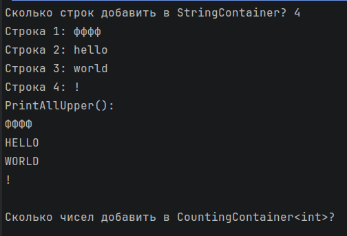

# КТ №27 — Иерархии обобщённых классов

**Вариант 1 — Контейнер**

- `class Container<T> { protected List<T> items = new(); public virtual void Add(T item) => items.Add(item); public int Count => items.Count; }`
- `class StringContainer : Container<string>` — фиксирует `T = string`, добавляет метод `PrintAllUpper()`, выводящий все строки в верхнем регистре.
- `class CountingContainer<T> : Container<T>` — оставляет `T` открытым, переопределяет `Add`, чтобы вести отдельный счётчик всех добавлений (`TotalAdded`), помимо обычного `Count`.
- Продемонстрирован `StringContainer` с несколькими строками и вызовом `PrintAllUpper()`.
- Продемонстрированы `CountingContainer<int>` и `CountingContainer<string>` — оба корректно считают добавления.
- Переопределённый `Add` вызывает базовую реализацию через `base.Add(...)`, а не дублирует логику добавления в список.

Все данные вводит пользователь; неверный ввод (пустая строка, не целое число) запрашивается повторно.

## Проверочные ключи

| Действие | Ожидаемый результат |
|---|---|
| StringContainer с ["привет", "мир"], PrintAllUpper() | выводит ПРИВЕТ, МИР |
| CountingContainer&lt;int&gt;, три вызова Add | Count == 3, TotalAdded == 3 |
| CountingContainer&lt;string&gt;, два вызова Add | Count == 2, TotalAdded == 2, независимо от предыдущего экземпляра |

## Запуск

```
dotnet run
```

## Результат выполнения


